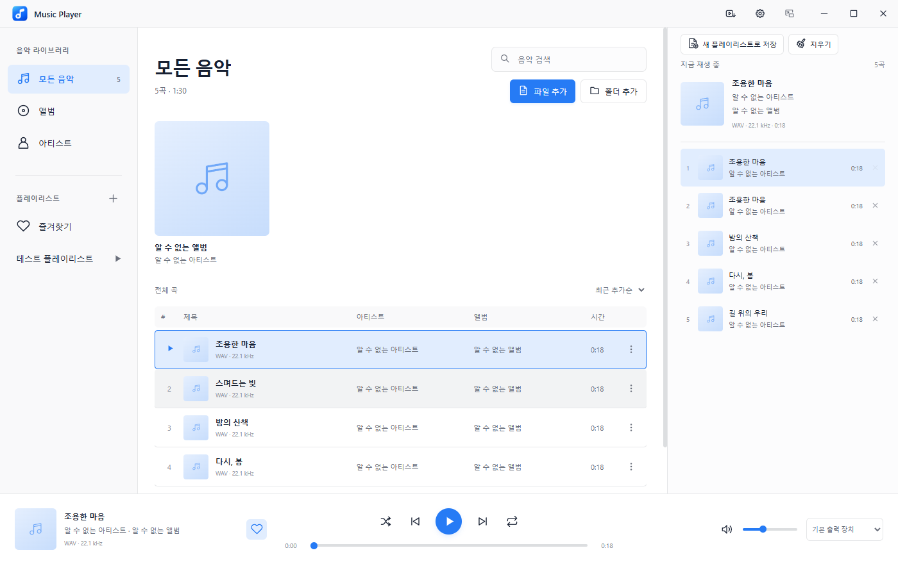
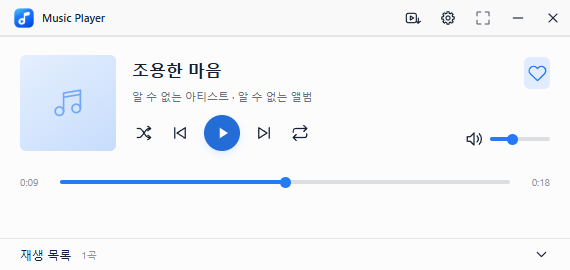

# Music Player

로컬 음악 재생과 유튜브 음원 추출을 지원하는 Windows용 음악 플레이어입니다. 현재 버전은 **1.1.0**입니다.

## 목차

1. [Music Player 소개](#music-player-소개)
2. [다운로드 및 실행](#다운로드-및-실행)
3. [음악 추가와 라이브러리 관리](#음악-추가와-라이브러리-관리)
4. [음악 재생과 재생 목록](#음악-재생과-재생-목록)
5. [플레이리스트 관리](#플레이리스트-관리)
6. [유튜브 음원 추출](#유튜브-음원-추출)
7. [축약 모드](#축약-모드)
8. [설정과 데이터 저장](#설정과-데이터-저장)
9. [지원 형식과 제한사항](#지원-형식과-제한사항)
10. [개발 및 빌드](#개발-및-빌드)

## Music Player 소개

Music Player는 컴퓨터에 있는 음악을 라이브러리에 등록하고, 플레이리스트와 재생 목록으로 정리해 듣는 프로그램입니다. 파일·폴더 가져오기, 검색과 정렬, 즐겨찾기, 다중 선택, 드래그로 곡 추가와 순서 변경을 지원합니다. 유튜브 링크에서 MP3를 추출해 라이브러리에 등록할 수도 있습니다.

기본 모드는 왼쪽에 라이브러리와 플레이리스트, 가운데에 곡 목록, 오른쪽에 재생 목록을 표시합니다. 하단에서 곡 정보, 재생 위치, 음량과 재생 방식을 조절합니다. 축약 모드로 전환하면 작은 창에서 같은 재생 상태를 이어서 제어할 수 있습니다.



## 다운로드 및 실행

폴더형 배포 파일 `Music Player 1.2.1 folder.zip`을 원하는 폴더에 압축 해제한 뒤, 그 안의 `Music Player.exe`를 실행합니다. EXE와 `resources` 폴더, DLL 등은 함께 보관해야 하며 EXE만 따로 옮기면 실행되지 않습니다. 바탕화면에는 실행 파일의 바로가기를 만들 수 있습니다. 단일 EXE 배포와 달리 실행할 때마다 압축을 풀지 않습니다.

배포 대상은 Windows x64이며 별도 설치 과정이 없습니다. 유튜브 음원 추출에 필요한 도구도 포함되어 있어 Node.js나 FFmpeg를 따로 설치하지 않아도 됩니다.

다른 버전의 Music Player가 실행 중이라면 먼저 완전히 종료한 뒤 새 버전을 실행합니다. 트레이로 이동한 상태에서는 트레이 메뉴의 ‘종료’를 사용합니다. 앱이 이미 실행 중일 때 실행 파일을 다시 열면 기존 창이 표시됩니다.

소스에서 실행하거나 직접 실행 파일을 만들려면 [개발 및 빌드](#개발-및-빌드)를 참고하세요.

## 음악 추가와 라이브러리 관리

### 파일과 폴더 추가

‘파일 추가’ 또는 ‘폴더 추가’로 음악을 등록합니다. 파일 선택창에서는 Ctrl·Shift로 여러 파일을 선택할 수 있으며, 파일이나 폴더를 앱에 드래그해서 가져올 수도 있습니다. 폴더 추가 시에는 선택한 폴더만 읽을지 하위 폴더까지 읽을지 선택합니다. 폴더를 드래그하면 하위 폴더까지 읽습니다.

같은 경로의 파일은 라이브러리에 중복 등록하지 않습니다. 파일·폴더 추가는 마지막으로 선택한 경로를 기억하며, 앱을 다시 실행해도 유지됩니다. 일반 음악 파일을 등록할 때 원본 파일을 복사하거나 이동하지 않습니다.

### 검색과 정렬

왼쪽의 ‘모든 음악’, ‘앨범’, ‘아티스트’에서 곡을 찾아볼 수 있습니다. 검색창은 제목·아티스트·앨범을 대상으로 검색하며, 정렬 메뉴에서 최근 추가순·제목순·아티스트순·앨범순·목록 순서를 선택할 수 있습니다.

재생 중인 곡은 하단의 하트 버튼으로, 다른 곡은 더보기 메뉴로 즐겨찾기를 지정합니다. 왼쪽의 ‘즐겨찾기’에서 모아 볼 수 있습니다.

### 다중 선택과 메뉴 작업

곡을 클릭하면 선택합니다. Ctrl+클릭은 개별 곡을 선택하거나 선택 해제하고, Shift+클릭은 구간을 선택합니다. 곡 목록에서 Ctrl+A를 누르면 현재 표시된 곡을 모두 선택합니다.

선택한 곡을 우클릭하거나 더보기 버튼을 누르면 재생, 바로 다음에 재생, 재생 목록 맨 뒤에 추가, 즐겨찾기, 파일 위치 열기와 라이브러리 삭제를 선택 전체에 적용합니다. 선택하지 않은 곡의 메뉴를 열면 해당 곡 하나만 대상으로 합니다. 즐겨찾기 여부가 섞인 선택에서는 ‘즐겨찾기 추가’로 모두 추가하고, 모두 즐겨찾기인 선택에서는 ‘즐겨찾기 해제’로 모두 해제합니다.

### 라이브러리에서 삭제

더보기 메뉴의 ‘라이브러리에서 삭제’는 앱에 등록된 정보를 제거합니다. 해당 곡은 플레이리스트·즐겨찾기·재생 목록에서도 빠지지만 원본 음악 파일은 삭제되지 않습니다. 현재 재생 중인 곡을 삭제하면 재생을 멈추며, 다른 곡을 삭제할 때는 현재 재생을 유지합니다.

## 음악 재생과 재생 목록

### 곡 재생

라이브러리의 곡을 두 번 클릭하거나 Enter를 누르면 기존 재생 목록을 그 곡 하나로 바꾸고 재생합니다. 여러 곡을 선택한 뒤 메뉴의 ‘지금 재생’을 누르면 선택한 곡을 화면에 표시된 순서대로 재생 목록에 넣고 첫 곡부터 재생합니다.

하단에서 재생·일시정지, 이전·다음 곡, 재생 위치, 음량과 음소거를 조절합니다. 이전·다음 이동은 현재 재생 목록 안에서 이루어집니다. 셔플은 아직 재생하지 않은 항목에서 다음 곡을 선택하며, 반복 버튼은 반복 끔·전체 반복·한 곡 반복 순서로 전환됩니다.

### 재생 단축키

기본 모드와 축약 모드에 동일하게 적용됩니다. Space는 재생·일시정지, ←/→는 재생 위치 이동, Ctrl+←/→는 이전·다음 곡, ↑/↓는 음량을 5%씩 조절합니다. M은 음소거, S는 셔플을 켜고 끄며, R은 반복 끔·전체 반복·한 곡 반복 순서로 전환합니다.

←/→ 이동 간격은 기본 5초이며 설정의 ‘방향키 이동 간격’에서 1~600초로 바꿀 수 있습니다. 재생 단축키는 검색·이름 입력, 메뉴·대화상자와 설정·추출 팝업을 포함해 앱의 모든 창에서 동작합니다. 지정된 키는 문자·공백 입력, 커서 이동, 슬라이더·버튼 조작에 사용되지 않고 해당 재생 기능만 실행합니다. 재생 위치·음량 슬라이더에 포커스가 있어도 ←/→는 재생 위치만, ↑/↓는 음량만 조절합니다.

### 재생 목록에 곡 추가

곡의 메뉴에서 ‘바로 다음에 재생’ 또는 ‘재생 목록 맨 뒤에 추가’를 선택합니다. 라이브러리의 곡이나 선택한 여러 곡, 앨범·아티스트 카드, 플레이리스트 안의 곡을 오른쪽 재생 목록으로 드래그해서 추가할 수도 있습니다.

드래그 중에는 악센트 색 선으로 추가될 위치를 표시합니다. 곡의 위쪽에 놓으면 앞에, 아래쪽에 놓으면 뒤에 들어갑니다. 곡 목록 바깥의 재생 패널 영역에 놓으면 맨 뒤에 추가됩니다. 추가 작업은 현재 곡과 재생 위치를 바꾸지 않으며, 같은 곡을 재생 목록에 여러 번 넣을 수 있습니다.

왼쪽 플레이리스트 자체를 드래그하면 저장된 곡 순서와 중복 항목을 그대로 추가합니다. 이때 현재 화면의 검색·정렬 조건은 적용하지 않습니다.

### 순서 변경과 목록 지우기

재생 목록 안의 곡을 드래그하면 이동할 위치를 선으로 확인하고 순서를 바꿀 수 있습니다. 목록의 곡을 두 번 클릭하면 기존 목록을 유지하면서 해당 곡으로 이동합니다. 현재 곡 이외의 항목은 각 행의 제거 버튼으로 뺄 수 있습니다.

상단의 ‘지우기’는 현재 곡을 포함한 재생 목록 전체를 비우고 재생을 멈춥니다. 라이브러리와 원본 파일은 유지됩니다.

## 플레이리스트 관리

### 만들기와 편집

왼쪽 플레이리스트 영역의 추가 버튼으로 새 목록을 만듭니다. 이름을 입력한 뒤 Enter를 누르거나 저장 버튼을 누릅니다. 이름 변경과 플레이리스트 삭제는 해당 목록 화면에서 할 수 있습니다.

플레이리스트 화면의 ‘플리에 추가’ 또는 ‘폴더 추가’로 가져온 음악은 해당 플레이리스트와 전체 라이브러리에 함께 등록됩니다. 이미 라이브러리에 있는 곡도 플레이리스트에 추가할 수 있으며, 같은 플레이리스트에 중복해서 추가하지는 않습니다.

라이브러리의 곡을 왼쪽 플레이리스트에 드래그하면 해당 목록에 추가됩니다. 앨범·아티스트 카드를 드래그하면 그 묶음의 곡 전체를 추가합니다. 곡 메뉴의 ‘이 플레이리스트에서 제거’는 해당 목록에서만 곡을 뺍니다.

### 순서 변경과 재생

왼쪽 플레이리스트 자체를 드래그하면 악센트 색 선으로 위치를 확인하며 목록 순서를 바꿀 수 있습니다. 플레이리스트 내부의 곡도 같은 방식으로 순서를 변경합니다. 곡 순서를 직접 바꾸면 정렬은 ‘목록 순서’로 전환되고 변경 내용이 저장됩니다. 검색 중에는 표시된 곡만 재배치하고 숨겨진 곡의 자리는 유지합니다.

플레이리스트 화면의 곡을 두 번 클릭하면 현재 화면의 곡 목록을 재생 목록으로 불러오고 해당 곡부터 재생합니다. 왼쪽 플레이리스트의 재생 버튼은 검색 조건을 비우고 현재 정렬 순서의 첫 곡부터 재생합니다.

### 재생 목록을 플레이리스트로 저장

오른쪽 재생 목록의 ‘새 플레이리스트로 저장’을 누르고 이름을 입력하면 현재 목록을 새 플레이리스트로 만듭니다. 중복된 곡과 항목 순서를 그대로 저장하며 현재 재생은 유지합니다. 저장한 목록은 ‘목록 순서’ 정렬로 열립니다. 빈 재생 목록에서는 저장 버튼이 비활성화됩니다.

## 유튜브 음원 추출

설정 버튼 왼쪽의 유튜브 추출 버튼을 누르면 팝업이 열립니다. 추출할 영상 링크와 저장할 폴더 경로를 입력합니다. 폴더 아이콘으로 저장 위치를 선택하고, 옆의 ‘열기’ 버튼으로 입력한 폴더를 탐색기에서 열 수 있습니다.

‘추출’을 누르면 영상 한 개의 음원을 MP3로 준비합니다. 추출이 끝난 뒤 ‘저장’을 누르면 지정한 폴더에 파일을 저장하고 ‘모든 음악’에 등록합니다. ‘자동 저장’을 체크하면 추출 완료 후 저장과 라이브러리 등록까지 이어집니다.

저장 경로와 자동 저장 선택은 다음 실행에도 유지됩니다. 저장 경로를 바꾸면 이후 저장에 적용되며, 이미 저장한 파일을 자동으로 옮기지는 않습니다. 같은 이름의 파일이 있으면 번호를 붙여 저장하고 기존 파일은 덮어쓰지 않습니다. 추출·저장은 현재 음악 재생을 바꾸지 않습니다.

추출 진행 상태와 오류는 팝업 안에 표시됩니다. 추출 중 팝업을 닫으면 진행 중인 추출을 취소합니다.

## 축약 모드

제목 표시줄의 모드 전환 버튼으로 기본 모드와 축약 모드를 오갑니다. 축약 모드는 곡 정보, 즐겨찾기, 재생 제어, 재생 위치와 음량을 작은 창에 표시합니다. 모드를 바꿔도 현재 곡과 재생 상태는 이어집니다.

하단의 ‘재생 목록’을 누르면 같은 목록을 아래로 펼치거나 접습니다. 펼친 목록에서는 곡 이동·제거와 드래그 순서 변경을 할 수 있습니다. ‘새 플레이리스트로 저장’과 ‘지우기’ 버튼은 기본 모드에서 사용합니다. 목록 펼침 상태는 모드를 전환하는 동안 유지됩니다.

설정과 유튜브 추출 팝업은 축약 모드에서도 열 수 있습니다.



## 설정과 데이터 저장

### 테마와 글꼴

제목 표시줄의 설정 버튼으로 설정 팝업을 엽니다. 테마 탭에서 시스템·라이트·다크 모드와 기본·그래파이트·오션·포레스트·샌드 테마를 선택할 수 있습니다. 악센트·배경·전경 색상은 색상 선택기나 HEX 코드로 지정하고, 글꼴도 변경할 수 있습니다.

라이트·다크 모드의 색상은 각각 저장합니다. 다른 테마를 선택하면 색상은 해당 테마의 기본값으로 돌아갑니다. ‘기본값으로 복원’은 테마 설정을 초기화합니다. 변경한 스타일은 기본·축약 모드와 설정·추출 팝업에 적용되며 자동으로 저장됩니다.

### 트레이 동작

기본 설정에서 ‘닫으면 트레이로 이동’을 켜면 닫기 버튼이나 Alt+F4로 창을 닫아도 음악 재생이 이어집니다. 트레이 아이콘을 두 번 클릭하거나 메뉴의 ‘Music Player 열기’를 선택하면 창을 복원합니다. 트레이 메뉴의 ‘종료’는 앱을 완전히 종료합니다. 이 옵션의 기본값은 꺼짐입니다.

### 저장과 복원

라이브러리·플레이리스트·즐겨찾기·재생 목록, 현재 곡과 재생 위치, 음량, 설정과 추출 저장 옵션은 Electron 사용자 데이터 폴더의 `library.json`에 자동 저장됩니다. 다시 실행하면 이전 곡과 위치를 불러오고 일시정지 상태로 시작합니다.

`library.json`에는 원본 음악 파일 자체가 들어 있지 않습니다. 탐색기에서 파일을 옮기거나 이름을 바꾸면 기존 경로로 등록된 항목은 재생할 수 없으며, 현재 버전은 변경된 파일 위치를 자동으로 찾아 연결하지 않습니다.

## 지원 형식과 제한사항

MP3, FLAC, WAV, M4A, AAC, OGG, Opus, WMA와 AIFF 파일을 등록할 수 있습니다. 실제 재생 가능 여부는 Electron/Chromium이 지원하는 코덱에 따라 달라집니다. 출력 장치 목록에는 운영체제와 Chromium이 제공하는 장치가 표시됩니다.

유튜브 추출은 HTTPS 영상 링크 한 개를 대상으로 하며, 유튜브 플레이리스트 링크를 한 번에 추출하는 기능은 없습니다. 로그인이나 별도 접근 권한이 필요한 영상, 접근이 제한된 영상은 추출에 실패할 수 있습니다. 추출 중에는 인터넷 연결이 필요하며 유튜브 측 변경으로 동작이 달라질 수 있습니다.

하드웨어 미디어 키와 여러 물리적 출력 장치의 전환은 사용 환경에서 별도 확인이 필요합니다. Windows의 기본 음악 앱으로 등록하는 파일 연결 기능은 현재 포함되어 있지 않습니다.

## 개발 및 빌드

### 개발 환경과 소스 실행

Windows x64와 Node.js 22 x64 환경에서 개발·빌드·검증했습니다. 저장소 루트에서 의존성을 설치한 뒤 실행합니다.

```powershell
npm ci
npm start
```

실행·테스트·패키징 준비 단계에서 SVG 아이콘을 빌드하고 유튜브 추출 도구를 준비합니다. 처음 준비할 때는 인터넷 연결이 필요하며, 도구는 `tools/youtube/`에 저장합니다. 이후에는 준비된 도구를 재사용합니다. 릴리즈에는 yt-dlp, FFmpeg·ffprobe와 Node.js 실행 도구 및 관련 라이선스 정보를 포함합니다.

### 테스트

```powershell
npm test
```

Playwright로 실제 Electron 창을 실행해 파일·폴더 등록, 검색, 재생, 재생 목록, 플레이리스트, 다중 선택과 삭제, 모드 전환, 설정, 트레이와 재실행 복원을 검사합니다. 유튜브 추출 팝업의 수동·자동 저장, 경로 선택·열기와 저장 옵션 유지도 검사합니다.

테스트는 격리된 임시 프로필과 테스트용 음악 파일을 사용하며 사용자 라이브러리를 사용하지 않습니다. 자동 테스트에서는 유튜브 네트워크 다운로드, 네이티브 파일 선택창과 탐색기 호출을 대체합니다. 실제 유튜브 다운로드와 하드웨어 미디어 키·물리적 출력 장치는 별도 확인 대상입니다. 확인용 화면은 `test-results/`에 저장합니다.

### 패키징

```powershell
npm run pack
```

Windows 휴대용 단일 실행 파일 `release/Music Player.exe`를 생성합니다.

폴더형 Windows x64 배포 ZIP을 만들려면 다음 명령을 사용합니다.

```powershell
npm run pack:folder
```

현재 버전의 ZIP은 `release/Music Player 1.2.1 folder.zip`이며, 바로 실행할 수 있는 앱 폴더는 `release/win-unpacked/`에 생성됩니다. 배포할 때는 ZIP 전체를 전달하고 사용자는 빈 폴더에 압축을 해제합니다.

### 아이콘 수정

버튼과 화면의 SVG 아이콘 원본은 `assets/icons/`에 있습니다. 원본을 수정하면 다음 실행·테스트·패키징 준비 단계에서 `src/icons.js`가 다시 생성됩니다. 아이콘만 갱신하려면 다음 명령을 사용합니다.

```powershell
npm run build:icons
```

앱 창·트레이·Windows 실행 파일의 아이콘은 `assets/music-player.ico`를 사용합니다.
